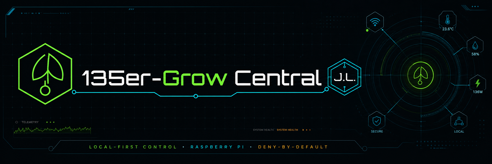

<strong>Open Source · Local First · Raspberry Pi · Desktop + Mobile</strong>

# 135er-Grow Central

## Verifizierter Pi-Livestand und Git-Synchronisierung · 14. November 2026

**Der Entwicklungsstopp ist aufgehoben.** Der installierte Raspberry Pi 4 meldet `SOURCE_COMMIT=be24ba9097c2e98eb1e3f302b5992c004d2e6e29` und `BUILD=operator-be24ba9097c2-base508` (`OPERATOR_PROVISIONED`). Dieser Betreiber-Livestand ist die Referenz für die synchronisierte Laufzeit, nicht der ältere veröffentlichte Image-Candidate 461.

Der vollständige Dateipfadvergleich ergab 755 identische Pi-/Git-Dateien, 102 absichtlich erhaltene Git-Projektdateien sowie 20 bewusst verschiedene Dokumentations-, Test- und Sicherheitspfade. Die Pi-Laufzeitmodule und die Final-Master-Weboberfläche wurden mit Original-Git-Blobhashes bestätigt; die abweichenden modernen Wartungs-/First-Boot-Sicherheitsprüfungen in Git bleiben erhalten. **QA:** 507 Tests bestanden, 2 native Broker-Tests unter dem Dienstbenutzer separat mit 13 Tests bestanden (plus 26 Untertests). Betriebsdaten und Herstellerbilder ohne Weiterverteilungsrechte gehören nicht in das öffentliche Repository.

[**Vollständiger Pi-/Git-Abgleichbericht**](docs/de/PI_GIT_RECONCILIATION_2026-11-14.md) · [Quell-Sicherungsarchiv](https://github.com/jygnw29kms-bit/135er-Grow-Central/tree/archive/pi-live-2026-11-14)

## Open-Source-Grundsatz

Grow Central wird **vollständig als Open-Source-Projekt** entwickelt. Das Repository ist die zentrale öffentliche Referenz für Quellcode, Dokumentation, Build-Informationen und veröffentlichbare Artefakte.

- Beiträge, Issues und Pull Requests sind ausdrücklich willkommen.
- Die kanonische Dokumentation wird öffentlich gepflegt.
- Build- und Release-Informationen werden nachvollziehbar dokumentiert.
- Sicherheitsrelevante Geheimnisse, Zugangsdaten, private Schlüssel und personenbezogene Daten gehören niemals ins Repository.
- Die Open-Source-Lizenz gilt für die jeweils veröffentlichten Projektbestandteile gemäß `LICENSE`.

## Letzter veröffentlichter Image-Candidate (historisch)

| Bereich | Stand |
|---|---|
| Version | `alpha-0.7.5` |
| Aktueller Pi-Candidate | **Build 461** |
| Release-Tag | `pi-universal-alpha-0.7.5-461` |
| Quellstand des Candidates | `5af7a97ee632a4ccaf32893c3c02735ac75bfadd` |
| Historischer Kandidat | 12. November 2026 |
| Aktuelle Image-Verteilung | **Ausschließlich Betreiber-Images, keine neuen öffentlichen Downloads** |
| Status | `CANDIDATE` – automatisierte Gates bestanden, reale Hardwarevalidierung je Hardwareklasse offen |
| Entwicklungsmodus | **Open Source / öffentlich** |

Verbindliche Detailquelle ist [`RELEASE_STATE.md`](RELEASE_STATE.md). Historische Build-Dokumente bleiben nachvollziehbar, definieren aber nicht den aktuellen Projektstand. Der `master`-Branch kann bereits neuere Quellcodeänderungen als der letzte veröffentlichte Image-Candidate enthalten.

## Bestätigter Sensor-Teststand · 14. Oktober 2026

Der ver?ffentlichte Pi-Candidate **Build 461** enth?lt die aktuelle Sensor-Firmware **0.5.3** und den zusammengef?hrten USB-/MQTT-TLS-/Bodenfeuchte-Pfad. Der reale Pi-4-Sensortest vom 14. Oktober bleibt als historischer Hardwarebefund erhalten; aktuelle Installationen verwenden keine separaten In-place-Hotfix-Skripte mehr.

- [Sensor einrichten und kalibrieren](docs/de/SOIL_SENSOR_GUIDE.md)
- [Hardwarebefund und offene Prüfungen](docs/de/SENSOR_HARDWARE_TEST_2026-10-14.md)
- [Aktueller Projektstatus](docs/PROJECT_STATUS.md)

Der HW-390 misst einen kapazitiven Feuchte-Referenzwert. Temperatur, pH und EC erfordern zusätzliche Hardware. Der erfolgreiche Sensortest ist keine vollständige Validierung des Universal-Images oder anderer Hardwareklassen.

**Betreiber-Images ausschließlich privat:** Öffentliche Image-Downloads sind bis zur vollständigen Abnahme ausgesetzt. Der historische Build-461-Kandidat dient nur als Versionsreferenz. Die Hardwareabnahme für Raspberry Pi 4, First Boot, FC3000 und DF150-M erfolgt nach [End-to-End-Testplan](docs/de/PI4_END_TO_END_ABNAHME_2026-11-12.md). Die zwei Mars-Hydro-Geräte sind getrennt mit Bluetooth und 2,4-GHz-WLAN erfasst, aber Steuerung/Verbindung wurden noch nicht am echten Gerät validiert.

## Nächster privater Hardwaretest · 13. November 2026

Der komplette aktuelle GitHub-`master` bildet die Quellbasis für das nächste **private Betreiber-Testimage**. Die Image-Pipeline bindet die Mars-Hydro-BLE-Lesepfade, Sensor-/USB-Firmware, HomeKit, Final-Master-Weboberfläche und automatisch startende Wartungsdienste ein. Der Betreiber-Build provisioniert individuell autorisierten SSH- und MeshCentral-Zugriff sowie eindeutige API-Tokens.

**Abnahme und Fortschritt:** [Betreiber-Image-Testplan für den 13. November](docs/de/OPERATOR_IMAGE_TEST_2026-11-13.md) und [Release-Status](RELEASE_STATE.md). Die Quell-/Build-Gates wurden geprüft, ein **flashbares neues Betreiber-Image wurde noch nicht erstellt**, sodass derzeit keine neue Image-Datei als Download angeboten wird.

## Produktprinzipien

- **Local First:** Steuerung, Messwerte und Automationen bleiben grundsätzlich vor Ort verfügbar.
- **Headless Appliance:** Der Pi benötigt keinen eigenen Desktop oder Monitor.
- **Eine Oberfläche pro Gerätetyp:** Desktop- und Mobile-Ansichten sind für ihren jeweiligen Einsatz optimiert.
- **Herstellerübergreifend:** Geräte werden über eine gemeinsame Plattform eingebunden.
- **Sichere Standardwerte:** Keine bekannten Factory-Passwörter; der SSH-Dienst läuft im neuen Universal-Image mit schlüsselgebundener Wartung und LAN-Firewall, aber ohne vorinstallierten Login-Schlüssel.
- **Optionale Cloud:** Fernzugriff und Verwaltung können ergänzt werden, die lokale Instanz bleibt maßgeblich.

## Standard-Fernwartung in neuen Pi-Images

Das Universal-Image enthält einen automatisch startenden SSH-Wartungsdienst, First-Boot-Schlüssel-Provisionierung, einen MeshCentral-Agenten-Dienst und einen Watchdog. **Der herunterladbare Build enthält keine gemeinsam verwendbaren Wartungszugänge.** Für die schlüsselgebundene Administration wird beim ersten Boot einmalig ein autorisierter persönlicher Public-Key eingebunden; ein MeshCentral-Agent wird mit einer individuellen Serverregistrierung aktiviert und startet anschließend bei jedem Boot automatisch. Die laufende Hardwareinstallation wird dadurch nicht rückwirkend verändert.

[Details zur Image-Provisionierung](image-builder/README.md) · [Wartungsagent und Installation](docs/de/GC_PI_MAINTENANCE_AGENT.md).

## Geplanter und implementierter Funktionsumfang

- geführte Ersteinrichtung mit Netzwerkübernahme;
- Räume, Grow-Bereiche und Gerätezuordnung;
- Sensorwerte, Verlauf und Zustandsübersicht;
- Zeitpläne und zustandsbasierte Automationen;
- Kamera-Unterstützung für geeignete UVC-Geräte;
- einheitliche Diagnose- und Laufzeitübersicht;
- Desktop-Weboberfläche sowie eigene mobile Oberfläche;
- iOS-Sideload- und Android-Testclients;
- optionale Cloud- und Verwaltungsfunktionen.

Der jeweilige Funktionsstatus ist modell-, firmware- und hardwareabhängig. Eine vorhandene Integration bedeutet nicht automatisch, dass sämtliche Lese- und Schreibfunktionen bereits für jedes Gerät freigegeben sind.

## Geräteökosysteme

Aktuell werden Integrationspfade für unter anderem folgende Systeme entwickelt oder validiert:

- AVM FRITZ! Smart Home
- TP-Link Tapo
- Shelly
- Tuya / Smart Life
- Mars Hydro
- Spider Farmer
- Home Assistant
- Zigbee2MQTT und generisches MQTT
- Grow-Central-ESP32-Sensoren und -Aktoren
- Logitech C920 und weitere geeignete UVC-Kameras

Schreibzugriffe bleiben gesperrt, solange Protokoll, Modell oder Firmware nicht ausreichend validiert sind.

## Hardwarestrategie

Grow Central verwendet weiterhin ein Universal-Image mit zentraler Hardwareerkennung.

| Hardware | Klasse | Einordnung |
|---|---|---|
| Raspberry Pi 3B / 3B+ | Legacy/Lite | unterstützt mit konservativen Ressourcenprofilen |
| Raspberry Pi 4B / 400 / CM4 | Full Support | empfohlene Standardplattform |
| Raspberry Pi 5 / CM5 | Full Support Performance | Plattform mit zusätzlicher Leistungsreserve |

Separate Images entstehen nur, wenn unterschiedliche Kernel-, Paket- oder Servicebasen technisch zwingend werden.

## Release-Regeln

1. `master` und die kanonische Dokumentation bilden den neuesten bekannten Quellstand ab.
2. Ein erfolgreicher CI-Lauf oder Image-Build erhält zunächst den Status `CANDIDATE`.
3. `VALIDATED` wird erst nach dokumentiertem Test auf realer Zielhardware vergeben.
4. **Bis zur vollständigen Abnahme keine öffentlichen Pi-Images oder Image-Artefakte.** Betreiber-Images bleiben privat; Quellcode und nicht-sensitive Dokumentation bleiben Open Source.
5. Die öffentliche Projektseite unter [grow-central.de](https://grow-central.de/) dient als Einstiegspunkt und verweist auf Repository, Dokumentation und veröffentlichte Releases.
6. Zugangsdaten, Tokens, private Schlüssel, lokale Adressen, Diagnosepakete mit personenbezogenen Daten und sonstige Geheimnisse werden niemals veröffentlicht.
7. Projektfremde Komponenten geh?ren nicht in dieses Repository. Gemeinsame Infrastruktur darf nur ?ber klar getrennte Schnittstellen, Secrets, Releases und Dokumentation genutzt werden.

## Lizenz

Das Projekt steht unter der **MIT License**. Siehe [`LICENSE`](LICENSE).

Die MIT-Lizenz erlaubt Nutzung, Veränderung, Veröffentlichung, Weitergabe und Verkauf der Software unter den dort genannten Bedingungen. Drittanbieter-Komponenten können eigene Lizenzen und Hinweise enthalten; diese bleiben jeweils maßgeblich.

## Mitmachen

Beiträge sind willkommen. Für Änderungen bevorzugen wir nachvollziehbare Pull Requests mit Beschreibung, Tests bzw. Validierung und einer kurzen Dokumentation der Auswirkungen.

## Sicherheit

Bitte veröffentliche keine Zugangsdaten, API-Schlüssel, Tokens, privaten Zertifikate oder personenbezogenen Daten in Issues, Pull Requests oder Commits. Sicherheitslücken sollten verantwortungsvoll gemeldet und nicht unnötig öffentlich ausgenutzt werden.

## English summary

135er-Grow Central is a fully open-source, local-first Raspberry Pi platform for grow monitoring, device control and automation. The public repository is the canonical project reference for source code, documentation and publishable releases. Build 461 is a historical `alpha-0.7.5` hardware-test candidate; until hardware validation is complete, new Pi images are owner-only and are never published as public releases or artifacts.

## Verbindlicher Final Master: Lokal und Cloud

**Eine Oberfläche für alle Zugriffswege.** Die Pi-PWA unter `/ui` und der authentifizierte Cloud-Final-Master dürfen keine eigenständig entwickelten Dashboard-Varianten darstellen. Reihenfolge, Bezeichnungen, Layout und Zustandssemantik der Messwertkacheln bleiben identisch: **Temperatur → Luftfeuchte → Bodenfeuchte → Lichtstufe → Lüfterdrehzahl**. Cloud und lokaler Zugriff unterscheiden sich nur in Transport, Authentifizierung und tatsächlicher Live-Datenverfügbarkeit. Keine erfundenen Messwerte bei veralteten oder fehlerhaften Sensoren.

**Quellvertrag:** `web/gc-final.html` ist die maßgebliche Vorlage für die gemeinsamen Telemetrie-Kacheln. `cloud/portal/cloud-master.html` muss denselben `#liveTiles`-Block enthalten. Der CI-Test `tests/test_final_master_cloud_parity.py` überwacht diese Identität und die kulturübergreifende Phasen- und Bodenfeuchteanzeige. Die Cloud-spezifische API-Brücke (`cloud-master-bridge.js`) bleibt getrennt, damit keine Cloud-Zugangsdaten in das iFrame gelangen. Änderungen an gemeinsamen UI-Bausteinen müssen beide Clients und die zugehörigen Cache-Versionen aktualisieren.

**Betrieb:** Git-Merge bedeutet nicht automatisch Live-Deployment. Das öffentliche Cloud-Portal auf dem Plesk-Server muss separat aus `cloud/portal/` deployed und anhand der HTTP-Antworten kontrolliert werden. Der Pi bleibt dabei unverändert. Nicht verifizierte Rootserver-Deployments gelten nicht als abgeschlossen.

**Produktionsabgleich ohne Änderungen:** Auf dem Plesk-Host aus einem Checkout des gewünschten Git-Standes `python3 scripts/verify_cloud_final_master_deployment.py --cloud-root /var/www/vhosts/grow-central.de/135ercloud.grow-central.de` ausführen. Das Skript vergleicht 17 tatsächlich ausgelieferte Portal-, Final-Master-, Kulturphasen-, Growbuch- und Geräte-Assets bytegenau mit Git, meldet `MATCH`, `DIFF` oder `MISSING` und liefert bei Abweichungen einen Fehlercode. Es deployt nichts, prüft keine authentifizierte iPhone-Sitzung und ersetzt keinen funktionalen Live-Test. Alte Portalmodule dürfen erst nach Prüfung sämtlicher Abhängigkeiten gelöscht werden.

## Betreiberprüfung vom 15.11.2026: Cloud und Pi

- **Cloud:** Die 17 Final-Master- und Portalassets stimmen mit dem Git-Checkout überein; die drei UI-Paritätstests bestehen. Plesk nutzt in der lokalen Nginx-vhost-Konfiguration `X-Content-Type-Options: nosniff` und `Referrer-Policy: strict-origin-when-cross-origin`, nach `nginx -t` mit kontrolliertem Reload geprüft. Diese Host-Einstellung ist **kein Teil des Git-Deployments** und muss beim Plesk-Rebuild geprüft werden. Keine restriktive CSP oder HSTS ohne Browser-/WebSocket-Regression aktivieren.
- **Pi:** Die Kern-Dateien der lokalen Final-Master-Oberfläche und die geprüften Python-Einstiegspunkte stimmen mit Git überein, **die README weicht ab** und `SOURCE_COMMIT` bezeichnet weiterhin die ursprüngliche Build-508-Basis. Deshalb keinen vollständig aktuellen Gesamt-Release behaupten und den Marker nicht ohne komplettes Installationsaudit überschreiben.
- **Wiederholbarer Check:** `python3 scripts/verify_pi_installed_files.py --source-root /pfad/zum/git-checkout --installed-root /opt/135er-grow-central`. Der Vergleich ist lesend und meldet Abweichungen ausdrücklich. Authentifizierter iPhone-/Cloud-End-to-End-Test, echte Sensorwerte und Aktorsteuerung erfordern weiterhin gesonderte Abnahme.

## BLE-Liveprüfung (15.11.2026)

Der lokale Bluetooth-Adapter und die HomeKit-Dienste können aktiv sein, **obwohl die Mars-Hydro-Controller nicht erreichbar sind**. Der Pi meldete wiederholte `BleakDeviceNotFoundError`-Wiederverbindungen bei FC3000 und MZF002 und über elf Stunden alte Controller-Messdateien. Der reine Status `systemctl active` genügt deshalb ausdrücklich nicht zur Live-Abnahme.

Mit `python3 scripts/check_mars_ble_freshness.py` lässt sich die Frische der **tatsächlich vom Controller gemeldeten** Werte prüfen, ohne Lampe oder Lüfter zu steuern. Standardgrenze: 120 Sekunden; ein fehlender/veralteter Wert ist kein gültiger Livewert und führt zu Exit-Code 2. Die Prüfung verrät keine Tokens, ändert keine BLE-Verbindung und ersetzt weder eine Prüfung der Geräteversorgung noch eine bestätigte Bedienprobe. Bei längerer Abwesenheit erst Bluetooth-Sichtbarkeit und Stromversorgung prüfen, danach BlueZ-Kollisionen und Wiederverbindungsablauf untersuchen. Keine automatischen Steuerungsversuche als Reparatur.

## Wartung / Altlastenbereinigung (15.11.2026)

- **Cloud:** Die frei abrufbare alte Datei `index.plesk-original.backup.html` wurde nach bytegenauer Sicherung aus dem Document-Root entfernt und unter `/var/backups/grow-central/cloud-portal-legacy/` geschützt archiviert. Die produktiven Einstiegsseiten bleiben erreichbar. `scripts/verify_cloud_final_master_deployment.py` meldet künftig auch versehentlich öffentlich gelagerte HTML-Backup-Dateien als Fehler. Das Werkzeug löscht keine Dateien.
- **BLE:** Nicht angeschlossene FC3000/MZF002 sind **regulär offline**, kein nachgewiesener Hardwaredefekt. `ReconnectLogLimiter` fasst identische Wiederverbindungsfehler für jeweils 15 Minuten zusammen; Fehlerartwechsel und erfolgreiche Wiederverbindungen bleiben sichtbar. Die BLE-Versuche selbst werden weiterhin ausgeführt. Vier neue Limiter-Regressionstests sowie vier Tests der Messwertfrische wurden bestanden. Die drei betroffenen Module wurden mit Sicherungskopie auf den Test-Pi übernommen, der Backend-HTTP-Healthcheck und die angrenzenden Dienste waren anschließend erfolgreich.
- **Keine blinde Löschung:** `static/gc-worker.js`, alte Portal-Quellen und installierte PWA-Caches erst nach Prüfung aktiver Referenzen und Migrationspfade entfernen. Lokale Daten, Kalibrierungen, Zugangskonfigurationen und alte Hardware-Images nicht mit flüchtigen UI-Artefakten verwechseln.
- **Versionswahrheit:** `SOURCE_COMMIT` und `BUILD` am Pi zeigen weiterhin die ursprüngliche Image-Basis und dürfen nicht als Bestätigung eines vollständigen Source-Deployments umetikettiert werden.

## Wartungsstand 15.11.2026: Cloud/Pi bereinigt

Die alte alternative Cloud-Dashboard-HTML, der ungenutzte Cloud-Service-Worker und eine alte Plesk-Startseite sind nach Sicherung aus dem öffentlichen Webverzeichnis entfernt. Die Cloud-PWA nutzt ein eigenes Manifest mit `start_url: /`; die lokale Pi-PWA bleibt unter `/ui`. Dashboard-Elemente und Datenregeln sind weiterhin identisch. Der Live-Cloud-Deployment-Check vergleicht 17 Dateien, erkennt öffentliche Backupseiten und verbietet alte Parallel-PWA-Dateien.

Die USB- und BLE-Provisionierung verwenden jetzt den gemeinsamen Brokerstatus-Handler. Im Pi-Code fasst die BLE-Verbindungspipeline wiederholte Fehlermeldungen zusammen; absichtlich nicht angeschlossene Mars-Hydro-Geräte sind regulär offline.

**Automatisierte Prüfungen:** `scripts/verify_pi_installed_files.py --source-root <checkout> --runtime` erfasst den installierten aktiven Python-/PWA-Stand getrennt vom ursprünglichen Image-Marker. `scripts/verify_growcentral_readiness.py --mode all` prüft Pi und Cloud ohne Tokens/Steuerbefehle. Der neue `grow-central-readiness-audit.timer` startet diese Prüfung stündlich, zusätzlich zum bestehenden Web-Watchdog. 47 Funktions-/UI-Tests und 27 Provisionierungs-/Broker-Tests wurden bestanden; der neue Readiness-Check meldete 15/15 erfolgreich. Die echte authentifizierte iPhone-/Raum-/Sensor-End-to-End-Abnahme bleibt offen.

**Ausführliches Wartungsprotokoll:** [Bereinigung und Verifikation vom 15.11.2026](docs/MAINTENANCE_CLEANUP_2026-11-15.md).

## Cloudlink: Bodenfeuchte bei lokal vorhandenem Sensor (15.11.2026)

Die lokale `/api/v1/rooms/climate-overview`-Quelle meldete für den bestehenden Grow-Raum eine frische kalibrierte Bodenfeuchtemessung (bei der Diagnose 88,834 %); der authentifizierte Cloud-Remote-Agent fragte dieselbe Klimaübersicht erfolgreich ab (HTTP 200). Im Cloud-Final-Master wurde der Dashboard-Raum zuvor ausschließlich über `growJournal.roomId` gefunden. Bei einer noch nicht initialisierten Raum-ID konnte dadurch trotz vorhandener Daten eine leere Kachel erscheinen.

**Behebung:** `cloud/portal/gc-final-cloud.js` verwendet die vorhandene erste Raumübersicht als Fallback, solange die Raum-ID nicht bereitsteht. Die Cloud fragt die Klimaübersicht alle 30 Sekunden auch ohne Raumzuordnung erneut ab und versucht die Raumliste bei fehlender Auswahl nach 45 Sekunden erneut zu laden. Portal-, iFrame- und Dashboard-JavaScript haben neue Cache-Versionen. Test `test_cloud_soil_tile_survives_initial_room_selection_race` sichert das Verhalten ab.

**Verifikation:** Fünf Cloud-Paritätstests, JavaScript-Syntaxprüfung, 17/17 Cloud-Dateivergleich und HTTP 200 für Portal, Final Master, Parent-Skript und Dashboard-Skript. Eine visuelle Kontrolle in der tatsächlich angemeldeten iPhone-PWA ist separat erforderlich; HTTP 200 beweist keine gerenderte Live-Kachel. Sensorwerte werden nie aus dem Archiv als aktuell ausgegeben, und ungültige oder veraltete Messungen bleiben ausgeblendet.

## Cloud-Fernkanal-Status unabhängig von BLE-Geräten (15.11.2026)

Der Cloud-Final-Master zeigte auf dem iPhone `Verbindung prüfen`, obwohl die Cloud-Anmeldung und der WebSocket-Fernkanal aktiv waren. Ursache: Die Statuskachel war bisher an gleichzeitige **frische BLE-Werte von FC3000 und MZF002** gekoppelt; beide Geräte sind zurzeit absichtlich nicht angeschlossen. Auch der Cloud-Tab-Text `Fernkanal separat prüfen` war hart kodiert.

**Korrektur:** `cloud/portal/gc-final-cloud.js` prüft `/api/health` über die bereits authentifizierte Cloud-Datenbrücke und zeigt dann `Cloud-Kanal verbunden` bzw. `Cloud-Kanal prüfen`. Der Cloud-Tab meldet passend `Fernkanal verbunden` bzw. `Fernkanal nicht erreichbar`. Die Mars-Hydro-Kacheln zeigen ihren eigenen Offline-/Messwertstatus; daraus wird kein Ausfall des Grow-Pi abgeleitet. Die drei ausgelieferten Cache-Versionen (Portal, iFrame, Master-JavaScript) wurden angepasst.

Sechs Cloud-Paritätstests, JavaScript-Syntaxprüfung und der Byte-Abgleich aller 17 Cloud-Dateien sind bestanden. Eine erfolgreiche Gerätekanalabfrage wird bei physisch getrennter BLE-Hardware weiterhin keine frischen Mars-Messwerte erzeugen. Der authentifizierte Live-Blick auf dem iPhone ist gesondert zu bestätigen.

## Fehlerbehebung Cloud-Bodenfeuchte nach iPhone-Screenshot (15.11.2026, 14:46)

**Tatsächliche Ursache:** In der Cloud-Variante `cloud/portal/gc-final-cloud.js` wurde `climateOverview=data` ausgeführt, ohne zuvor `climateOverview` zu deklarieren. Das gesamte Cloud-Skript läuft in `'use strict'`; dadurch entstand bei einer erfolgreichen `/api/v1/rooms/climate-overview`-Antwort ein `ReferenceError`. Der gemeinsame `catch` zeigte deshalb gleichzeitig `Messung nicht erreichbar` für Bodenfeuchte und `Klimabewertung nicht erreichbar`, obwohl die lokale API weiter HTTP 200 mit einem gültigen kalibrierten Messwert lieferte.

**Fix:** `let climateOverview={rooms:[]};` vor der Funktion deklariert; Portal-/iFrame-/JS-Cacheversionen erneuert. Der vorhandene Raum-Fallback bleibt aktiv. Sieben Cloud-Vertragstests, JavaScript-Syntaxprüfung, 17/17 produktive Cloud-Dateien und ein ausführbarer Strict-Mode-Funktionstest mit frischem Snapshot (angezeigtes Ergebnis 88,8 %) wurden erfolgreich geprüft. Testdaten des Funktionstests sind ausdrücklich simuliert, nicht der aktuelle Sensormesswert. Die letzte echte Pi-Messung bei der Diagnose betrug 88,822 %. Die Darstellung in der authentifizierten iPhone-PWA muss abschließend erneut überprüft werden.

## iPhone 17 Pro Max: Live-Kamera im Cloud-/Pi-Final-Master (15.11.2026, 14:51)

Die angemeldete iPhone-PWA zeigte einen aktuellen Cloud-Kanal und ein tatsächlich geladenes Kamerabild mit Zeitstempel. Im Kamerabereich ragte das breite Bild rechts über den sichtbaren mobilen Darstellungsbereich hinaus. Das ist ein Layout-/Responsiveness-Befund, kein Kamera-Übertragungsfehler.

**Korrektur:** Beide freigegebenen Master-Stylesheets begrenzen `#largeCam` auf die verfügbare Containerbreite, setzen `min-width:0`, sichern ein 16:9-Verhältnis ohne starre Mindesthöhe, beschränken Bild und OSD auf die Rahmenbreite und erlauben mobilen Kamerabedienelementen einen responsiven Umbruch. Die lokale und die Cloud-PWA verwenden dieselbe Regel. Beide HTML-Einstiegsseiten haben aktualisierte CSS-Cacheversionen. Die Änderung wirkt nur auf die Darstellung, nicht auf Kamerasteuerung, Auflösung oder Aufnahmefunktionen.

**Verifiziert:** acht Cloud-GUI-Vertragstests bestanden; die Cloud-Produktionsdateien stimmen 17/17 mit Git überein; Pi-Backend und HomeKit weiterhin aktiv. Ein erneuter echter iPhone-Screenshot zur visuellen Abnahme steht noch aus.

## Verbindliche Regel: Final-Master-PWA auf `.local` und `.de` synchron halten

**Ein sichtbarer Funktionsstand, zwei Zugriffswege.** Die lokale Pi-Oberfläche (`growcentral.local`/`/ui`) und der authentifizierte Cloud-Final-Master (`135ercloud.grow-central.de`) müssen in ihrer Darstellung, Navigation, den vorhandenen Messwerten, Kamerabildeinblendungen, Sensor-Gültigkeitsregeln und Bedienungsabläufen denselben bestätigten Stand haben. Transport, Anmeldesitzung und Cloud-Gerätekanal sind absichtlich unterschiedlich; deshalb sind die vollständigen JS-Dateien technisch nicht bytegleich.

**Vor jedem Release verpflichtend:**
1. Jede sichtbare Änderung in `web/gc-final.html`, `web/gc-final.js`, `web/gc-final.css` gleichzeitig für `cloud/portal/cloud-master.html`, `cloud/portal/gc-final-cloud.js`, `cloud/portal/gc-final-cloud.css` umsetzen; keine eigenständige Cloud-GUI.
2. `tests/test_final_master_cloud_parity.py` ausführen. Der Cloud-Deploy-Workflow `cloud/portal/deploy_cloud_portal.sh` stoppt jetzt **vor dem Kopieren**, wenn ein UI-Paritätstest fehlschlägt. Der Test schützt unter anderem die fünf Dashboard-Kacheln, Sensorvalidierung, Kamera-OSD-Logik und die mobilen Kamera-Stile.
3. Auf Pi und Cloud mit aktualisierten PWA-Cacheversionen ausrollen. Bei Fehlern die jeweilige gesicherte Version wiederherstellen, keinen nur einseitig freigegebenen Stand als fertig ausweisen.
4. `scripts/verify_cloud_final_master_deployment.py` und `scripts/verify_pi_installed_files.py --runtime` gegen die Installationen ausführen; API und echte iPhone-Ansicht separat abnehmen.

**Kamera-OSD (15.11.2026):** Die Einblendung zeigt jeden **frischen** Messwert unabhängig: Temperatur und Luftfeuchte aus dem jeweils vorhandenen Sensorsignal, Bodenfeuchte aus dem gültigen, raumgebundenen Sensor-Snapshot. Sind Mars-Hydro-Geräte absichtlich offline, darf die verfügbare Bodenfeuchte nicht verschwinden. Alte/ungültige Messungen werden nicht als live ausgegeben. Der gleiche OSD-Renderer und die gleiche mobile Kamera-CSS sind in den Paritätstests in beiden Varianten wortgleich geprüft; beide JS-/HTML-Kombinationen wurden auf Pi und Cloud ausgerollt.

## PWA-Abgleich nach iPhone-LAN-Screenshot (15.11.2026, 15:47)

Ein iPhone-Screenshot von `135er-grow-central.local` zeigte sichtbare Abweichungen zur Cloud-PWA: drei getrennte Verbindungssignale (LAN, BLE-Licht, BLE-Lüfter) nur lokal; unterschiedliche mobile Navigation (`Räume` lokal, `Growbuch` Cloud); und eine abweichende Reihenfolge von Klimabewertung und Steuerkarten. Die auf dem Pi angezeigten 88,8 % Bodenfeuchte sind ein echter, frischer raumgebundener Messwert. Die beiden Mars-Hydro-Geräte sind laut Betreiber derzeit absichtlich nicht angeschlossen und melden entsprechend BLE getrennt.

**Korrekturen:** Die Cloud verwendet jetzt dieselbe Statusleiste, BLE-Datenqualitätsanzeige, mobile Menüfolge `Start · Geräte · Kamera · Räume · Cloud` sowie identische Styles und Status-Renderer. Der Cloud-Transport wird weiter über den authentifizierten Fernkanal geprüft; BLE-Offline bedeutet keinen Cloud-Ausfall. Das lokale Dashboard zeigt nach den fünf Messkacheln jetzt ebenfalls zuerst die Klimabewertung und Bodenfeuchte-Details und danach die Gerätesteuerkarten, entsprechend dem Cloud-Final-Master.

**Schutz gegen Rückfälle:** In `tests/test_final_master_cloud_parity.py` prüfen nun 14 Tests auch byteidentische mobile Navigation, Status-Markup, Signal-Renderer und die Dashboard-Komponentenreihenfolge. Das Cloud-Deployment führt die Paritätstests vor dem Kopieren aus. Die aktualisierten Cloud-Dateien wurden geprüft (17/17 identisch; HTTP 200); die drei lokalen Final-Master-Dateien wurden auf dem Pi bytegenau mit Git abgeglichen. Cache-Versionen beider Zugänge sind synchron `20261115-status-parity-1`. Die tatsächliche Darstellung der aktualisierten Cloud-PWA auf dem iPhone ist noch nicht visuell abgenommen.
