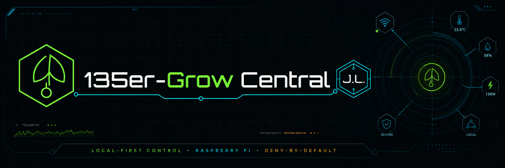

<strong>Open Source · Local First · Raspberry Pi · Desktop + Mobile</strong>

# 135er-Grow Central

> **Vollständig Open Source.** Entwicklung, Quellcode, Dokumentation, Images und veröffentlichbare technische Komponenten werden transparent über dieses Repository bereitgestellt.

135er-Grow Central ist eine lokale Steuerungs-, Überwachungs- und Automationsplattform für Grow-Umgebungen. Ein Raspberry Pi bildet die lokale Zentrale; Browser, Smartphone, Tablet und mobile Clients dienen als Bedienoberflächen. Eine Cloud-Anbindung ist optional und ersetzt nicht die lokale Geräteautorität.

## Open-Source-Grundsatz

Grow Central wird **vollständig als Open-Source-Projekt** entwickelt. Das Repository ist die zentrale öffentliche Referenz für Quellcode, Dokumentation, Build-Informationen und veröffentlichbare Artefakte.

- Beiträge, Issues und Pull Requests sind ausdrücklich willkommen.
- Die kanonische Dokumentation wird öffentlich gepflegt.
- Build- und Release-Informationen werden nachvollziehbar dokumentiert.
- Sicherheitsrelevante Geheimnisse, Zugangsdaten, private Schlüssel und personenbezogene Daten gehören niemals ins Repository.
- Die Open-Source-Lizenz gilt für die jeweils veröffentlichten Projektbestandteile gemäß `LICENSE`.

## Aktueller Referenzstand

| Bereich | Stand |
|---|---|
| Version | `alpha-0.7.5` |
| Aktueller Pi-Candidate | **Build 461** |
| Release-Tag | `pi-universal-alpha-0.7.5-461` |
| Quellstand des Candidates | `5af7a97ee632a4ccaf32893c3c02735ac75bfadd` |
| Historischer Kandidat | 12. November 2026 |
| Aktuelle Image-Verteilung | **Ausschließlich Betreiber-Images, keine neuen öffentlichen Downloads** |
| Status | `CANDIDATE` – automatisierte Gates bestanden, reale Hardwarevalidierung je Hardwareklasse offen |
| Entwicklungsmodus | **Open Source / öffentlich** |

Verbindliche Detailquelle ist [`RELEASE_STATE.md`](RELEASE_STATE.md). Historische Build-Dokumente bleiben nachvollziehbar, definieren aber nicht den aktuellen Projektstand. Der `master`-Branch kann bereits neuere Quellcodeänderungen als der letzte veröffentlichte Image-Candidate enthalten.

## Bestätigter Sensor-Teststand · 14. Oktober 2026

Der ver?ffentlichte Pi-Candidate **Build 461** enth?lt die aktuelle Sensor-Firmware **0.5.3** und den zusammengef?hrten USB-/MQTT-TLS-/Bodenfeuchte-Pfad. Der reale Pi-4-Sensortest vom 14. Oktober bleibt als historischer Hardwarebefund erhalten; aktuelle Installationen verwenden keine separaten In-place-Hotfix-Skripte mehr.

- [Sensor einrichten und kalibrieren](docs/de/SOIL_SENSOR_GUIDE.md)
- [Hardwarebefund und offene Prüfungen](docs/de/SENSOR_HARDWARE_TEST_2026-10-14.md)
- [Aktueller Projektstatus](docs/PROJECT_STATUS.md)

Der HW-390 misst einen kapazitiven Feuchte-Referenzwert. Temperatur, pH und EC erfordern zusätzliche Hardware. Der erfolgreiche Sensortest ist keine vollständige Validierung des Universal-Images oder anderer Hardwareklassen.

**Betreiber-Images ausschließlich privat:** Öffentliche Image-Downloads sind bis zur vollständigen Abnahme ausgesetzt. Der historische Build-461-Kandidat dient nur als Versionsreferenz. Die Hardwareabnahme für Raspberry Pi 4, First Boot, FC3000 und DF150-M erfolgt nach [End-to-End-Testplan](docs/de/PI4_END_TO_END_ABNAHME_2026-11-12.md). Die zwei Mars-Hydro-Geräte sind getrennt mit Bluetooth und 2,4-GHz-WLAN erfasst, aber Steuerung/Verbindung wurden noch nicht am echten Gerät validiert.

## Nächster privater Hardwaretest · 13. November 2026

Der komplette aktuelle GitHub-`master` bildet die Quellbasis für das nächste **private Betreiber-Testimage**. Die Image-Pipeline bindet die Mars-Hydro-BLE-Lesepfade, Sensor-/USB-Firmware, HomeKit, Final-Master-Weboberfläche und automatisch startende Wartungsdienste ein. Der Betreiber-Build provisioniert individuell autorisierten SSH- und MeshCentral-Zugriff sowie eindeutige API-Tokens.

**Abnahme und Fortschritt:** [Betreiber-Image-Testplan für den 13. November](docs/de/OPERATOR_IMAGE_TEST_2026-11-13.md) und [Release-Status](RELEASE_STATE.md). Die Quell-/Build-Gates wurden geprüft, ein **flashbares neues Betreiber-Image wurde noch nicht erstellt**, sodass derzeit keine neue Image-Datei als Download angeboten wird.

## Produktprinzipien

- **Local First:** Steuerung, Messwerte und Automationen bleiben grundsätzlich vor Ort verfügbar.
- **Headless Appliance:** Der Pi benötigt keinen eigenen Desktop oder Monitor.
- **Eine Oberfläche pro Gerätetyp:** Desktop- und Mobile-Ansichten sind für ihren jeweiligen Einsatz optimiert.
- **Herstellerübergreifend:** Geräte werden über eine gemeinsame Plattform eingebunden.
- **Sichere Standardwerte:** Keine bekannten Factory-Passwörter; der SSH-Dienst läuft im neuen Universal-Image mit schlüsselgebundener Wartung und LAN-Firewall, aber ohne vorinstallierten Login-Schlüssel.
- **Optionale Cloud:** Fernzugriff und Verwaltung können ergänzt werden, die lokale Instanz bleibt maßgeblich.

## Standard-Fernwartung in neuen Pi-Images

Das Universal-Image enthält einen automatisch startenden SSH-Wartungsdienst, First-Boot-Schlüssel-Provisionierung, einen MeshCentral-Agenten-Dienst und einen Watchdog. **Der herunterladbare Build enthält keine gemeinsam verwendbaren Wartungszugänge.** Für die schlüsselgebundene Administration wird beim ersten Boot einmalig ein autorisierter persönlicher Public-Key eingebunden; ein MeshCentral-Agent wird mit einer individuellen Serverregistrierung aktiviert und startet anschließend bei jedem Boot automatisch. Die laufende Hardwareinstallation wird dadurch nicht rückwirkend verändert.

[Details zur Image-Provisionierung](image-builder/README.md) · [Wartungsagent und Installation](docs/de/GC_PI_MAINTENANCE_AGENT.md).

## Geplanter und implementierter Funktionsumfang

- geführte Ersteinrichtung mit Netzwerkübernahme;
- Räume, Grow-Bereiche und Gerätezuordnung;
- Sensorwerte, Verlauf und Zustandsübersicht;
- Zeitpläne und zustandsbasierte Automationen;
- Kamera-Unterstützung für geeignete UVC-Geräte;
- einheitliche Diagnose- und Laufzeitübersicht;
- Desktop-Weboberfläche sowie eigene mobile Oberfläche;
- iOS-Sideload- und Android-Testclients;
- optionale Cloud- und Verwaltungsfunktionen.

Der jeweilige Funktionsstatus ist modell-, firmware- und hardwareabhängig. Eine vorhandene Integration bedeutet nicht automatisch, dass sämtliche Lese- und Schreibfunktionen bereits für jedes Gerät freigegeben sind.

## Geräteökosysteme

Aktuell werden Integrationspfade für unter anderem folgende Systeme entwickelt oder validiert:

- AVM FRITZ! Smart Home
- TP-Link Tapo
- Shelly
- Tuya / Smart Life
- Mars Hydro
- Spider Farmer
- Home Assistant
- Zigbee2MQTT und generisches MQTT
- Grow-Central-ESP32-Sensoren und -Aktoren
- Logitech C920 und weitere geeignete UVC-Kameras

Schreibzugriffe bleiben gesperrt, solange Protokoll, Modell oder Firmware nicht ausreichend validiert sind.

## Hardwarestrategie

Grow Central verwendet weiterhin ein Universal-Image mit zentraler Hardwareerkennung.

| Hardware | Klasse | Einordnung |
|---|---|---|
| Raspberry Pi 3B / 3B+ | Legacy/Lite | unterstützt mit konservativen Ressourcenprofilen |
| Raspberry Pi 4B / 400 / CM4 | Full Support | empfohlene Standardplattform |
| Raspberry Pi 5 / CM5 | Full Support Performance | Plattform mit zusätzlicher Leistungsreserve |

Separate Images entstehen nur, wenn unterschiedliche Kernel-, Paket- oder Servicebasen technisch zwingend werden.

## Release-Regeln

1. `master` und die kanonische Dokumentation bilden den neuesten bekannten Quellstand ab.
2. Ein erfolgreicher CI-Lauf oder Image-Build erhält zunächst den Status `CANDIDATE`.
3. `VALIDATED` wird erst nach dokumentiertem Test auf realer Zielhardware vergeben.
4. **Bis zur vollständigen Abnahme keine öffentlichen Pi-Images oder Image-Artefakte.** Betreiber-Images bleiben privat; Quellcode und nicht-sensitive Dokumentation bleiben Open Source.
5. Die öffentliche Projektseite unter [grow-central.de](https://grow-central.de/) dient als Einstiegspunkt und verweist auf Repository, Dokumentation und veröffentlichte Releases.
6. Zugangsdaten, Tokens, private Schlüssel, lokale Adressen, Diagnosepakete mit personenbezogenen Daten und sonstige Geheimnisse werden niemals veröffentlicht.
7. Projektfremde Komponenten geh?ren nicht in dieses Repository. Gemeinsame Infrastruktur darf nur ?ber klar getrennte Schnittstellen, Secrets, Releases und Dokumentation genutzt werden.

## Lizenz

Das Projekt steht unter der **MIT License**. Siehe [`LICENSE`](LICENSE).

Die MIT-Lizenz erlaubt Nutzung, Veränderung, Veröffentlichung, Weitergabe und Verkauf der Software unter den dort genannten Bedingungen. Drittanbieter-Komponenten können eigene Lizenzen und Hinweise enthalten; diese bleiben jeweils maßgeblich.

## Mitmachen

Beiträge sind willkommen. Für Änderungen bevorzugen wir nachvollziehbare Pull Requests mit Beschreibung, Tests bzw. Validierung und einer kurzen Dokumentation der Auswirkungen.

## Sicherheit

Bitte veröffentliche keine Zugangsdaten, API-Schlüssel, Tokens, privaten Zertifikate oder personenbezogenen Daten in Issues, Pull Requests oder Commits. Sicherheitslücken sollten verantwortungsvoll gemeldet und nicht unnötig öffentlich ausgenutzt werden.

## English summary

135er-Grow Central is a fully open-source, local-first Raspberry Pi platform for grow monitoring, device control and automation. The public repository is the canonical project reference for source code, documentation and publishable releases. Build 461 is a historical `alpha-0.7.5` hardware-test candidate; until hardware validation is complete, new Pi images are owner-only and are never published as public releases or artifacts.
