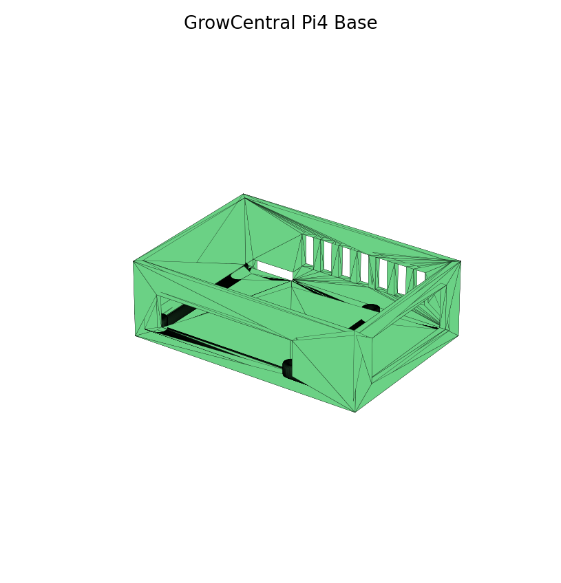
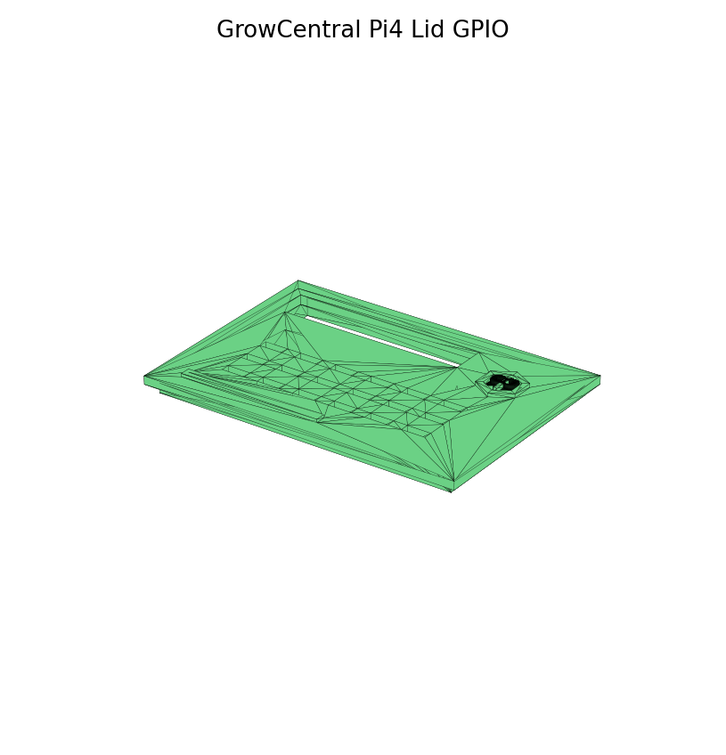
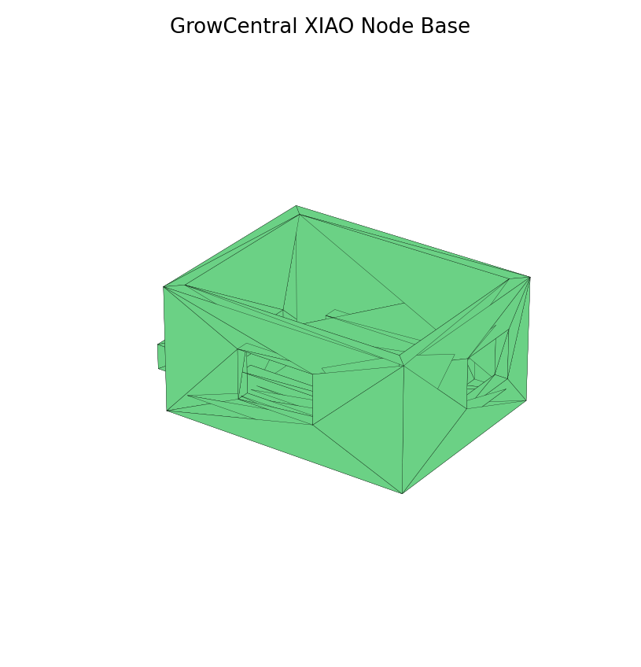
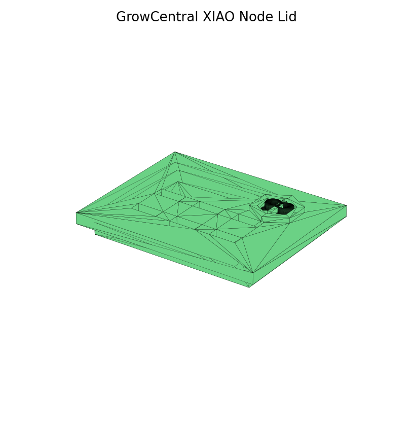
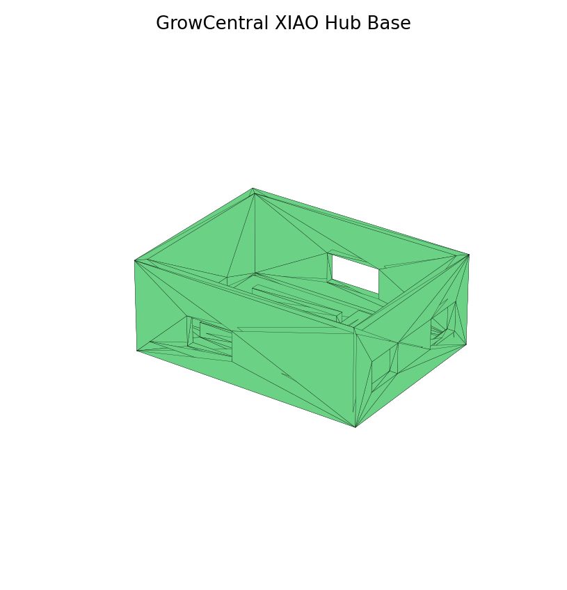
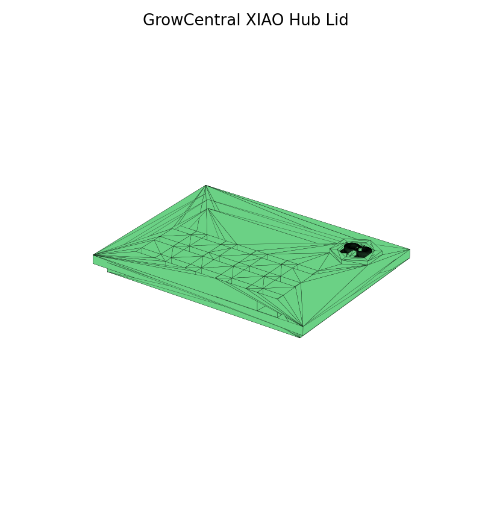

# Grow-Central FreeCAD enclosures

Parametric enclosure set generated with FreeCAD 1.1 for Grow-Central hardware.

## Raspberry Pi 4 GC Case
- Raspberry Pi 4 board envelope: 85 x 56 mm
- 58 x 49 mm mounting-hole pattern
- GPIO service opening in lid for full 40-pin header access
- USB-C / micro-HDMI side service opening
- USB/Ethernet opening
- microSD access
- cross-flow ventilation slots
- external cable-tie/tent mounting ear
- raised Grow-Central mark on lid
- exports: FCStd, STEP, STL

## XIAO ESP32-C3 Node
- compact enclosure for ~21 x 17.5 mm XIAO ESP32-C3
- designed with extra vertical clearance for soldered pin-header strips
- PCB support rails keep underside/header solder joints clear
- USB-C programming/service opening
- separate sensor cable exit
- ventilation slots
- wall/tent cable-tie mount
- raised Grow-Central mark
- exports: FCStd, STEP, STL

## XIAO ESP32-C3 Hub
- larger service enclosure for XIAO plus wiring/terminal distribution
- header clearance and PCB rails as in Node
- multiple cable exits
- internal connected distribution platform
- more ventilation area
- wall/tent cable-tie mount
- raised Grow-Central mark
- exports: FCStd, STEP, STL

## Manufacturing baseline
Designed for FDM printing. PETG is the default material for normal indoor/grow-room use; ASA is preferred for hotter or UV-exposed installations. Start with 0.4 mm nozzle, 0.20 mm layers, 4 walls and 4-5 top/bottom layers. Print base and lid flat on their largest surfaces.

## Regeneration
Run `build_gc_enclosures.py` with FreeCAD's bundled Python. `validate_gc_enclosures.py` checks FCStd solids, validity, volume and bounding boxes after generation.

## STL previews

### Raspberry Pi 4

### XIAO ESP32-C3 Node

### XIAO ESP32-C3 Hub

