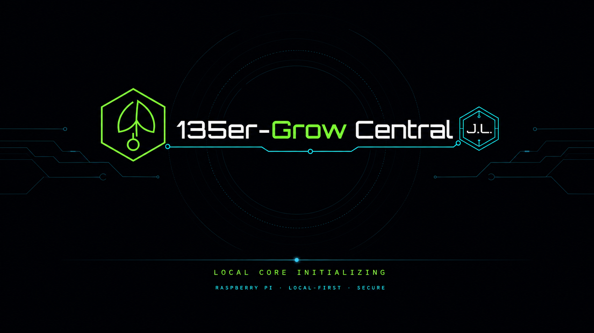

# GrowCentral Universal Raspberry Pi Image

This directory documents the reproducible 64-bit **universal image** for supported Raspberry Pi hardware.

## Hardware strategy

The image stays universal. Runtime model detection assigns one canonical support profile from `shared/hardware_profile.py`:

- Raspberry Pi 3B / 3B+ → `LEGACY_LITE`
- Raspberry Pi 4B / 400 / CM4 → `FULL_SUPPORT` standard
- Raspberry Pi 5 / CM5 → `FULL_SUPPORT` performance
- unknown hardware → `UNCLASSIFIED` conservative fallback

Pi 3 remains supported but must not constrain the feature baseline for Pi 4/5. Separate images are introduced only if different kernel/package/service bases become technically necessary.

## Base system

- Raspberry Pi OS Lite 64-bit / Debian 13 (Trixie)
- one image for Pi 3B/3B+, Pi 4/400, Pi 5 and compatible Compute Modules
- runtime model detection from device tree
- NetworkManager, systemd, BlueZ/BLE
- Python virtual environment with GrowCentral requirements
- diagnostics include detected model and support profile

## Resource profiles

### Legacy/Lite – Pi 3B/3B+

Conservative defaults: camera target up to 720p/reduced FPS, reduced kiosk effects, compact diagnostics history and conservative worker profile.

### Full Support – Pi 4/400/CM4

Full Nexus UI/Kiosk, standard worker profile, normal diagnostics history and full-support camera path.

### Full Support Performance – Pi 5/CM5

Full UI/Kiosk, performance worker profile and extended diagnostics history.

## First boot

1. Flash the universal image.
2. Join `135er-GrowCentral-Setup-XXXX`.
3. Open `http://10.42.0.1/`.
4. Complete network and credential setup.
5. After provisioning use `http://135er-GrowCentral.local/` or the assigned IP.
6. Verify the detected hardware profile in diagnostics.

The setup AP is restored automatically if the selected WLAN cannot be reached.

## Safe defaults

- `DF100M_ALLOW_WRITES=false`
- `GC_REMOTE_COMMANDS=false`
- `GC_CLOUD_ENABLED=false`
- root SSH login disabled
- **key-only SSH daemon enabled automatically on every new image**; port 22 restricted to private LAN ranges, no shared password or shared authorized key
- root-controlled maintenance account provisioned only with the owner's individual public key placed as `gc-maintenance.pub` on the boot partition before first boot
- preinstalled MeshCentral systemd unit plus SSH/Mesh health watchdog; MeshCentral enrolls only from owner-provided, device-specific agent files
- UFW enabled
- unattended security updates enabled

## Automatic build

`.github/workflows/build-pi3-image.yml` produces the universal ARM64 image, verifies the base checksum, installs GrowCentral and dependencies, performs boot/reboot and consistency checks, compresses the result and publishes an Actions artifact plus prerelease assets.

The workflow name is historical; its output is the project-wide **universal image**, not a Pi-3-only image.

## Validation

CI must test the profile classifier for Pi 3, Pi 4/400, Pi 5 and CM4/CM5. Real validation is recorded separately per support class according to `docs/HARDWARE_TEST_PLAN.md`.

Policy: `docs/HARDWARE_SUPPORT_POLICY.md`.

## Standard remote maintenance / MCP access

Every newly built universal image ships with `ssh.service`, `grow-central-firstboot-maintenance.service`, `grow-central-remote-watchdog.timer` and `grow-central-mesh-agent.service` enabled. The SSH host keys are **generated on the Pi**, not included in any downloadable image.

To authorize the device owner to use `gc-maint` with full administrative rights after first boot, place a **single trusted public key** named `gc-maintenance.pub` onto the SD card's `bootfs` partition (`/boot/firmware/gc-maintenance.pub` inside the Pi) before first boot. The first-boot service invokes the repository-shipped installer, validates the public key, creates `gc-maint` with key-only login and sudo, then removes the source copy from bootfs. No key means no maintenance login, though SSH transport stays available.

For MeshCentral-backed MCP remote control, only an individually enrolled device agent can connect to the owner's MeshCentral server. The standard image **preinstalls and enables** the corresponding unit and watchdog. Provide a Linux MeshCentral `meshagent` binary and its matching private `meshagent.msh` from your authenticated MeshCentral server, then run `scripts/enroll-gc-meshcentral-agent.sh` on the Pi. The unit starts automatically on every subsequent boot and restarts after transient failures. Neither server tokens nor private enrollment material are ever distributed in public images.

**The MCP server/ChatGPT connector is hosted separately**; a MeshCentral agent on the Pi is the endpoint it manages. Installing the image does not magically authorize an unrelated MCP account. These defaults apply to **new builds** only. An existing Pi needs a separately verified in-place migration; do not assume that updating GitHub modifies running hardware.
